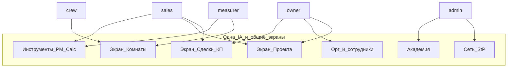

# D1 — Продуктовая архитектура

**Revision:** `rev-gate-a-approved-20261022`  
**Зависит от:** [D0](./project-context.md)  
**Статус Gate A:** согласован **условно** (три корректировки идентичности Deal/Quote/Project — [ADR-008](./adr/008-deal-quote-project-identity.md)).

---

## 1. Границы продукта

### Внутри MultiFrame Партнёр

| Домен | Суть | Для кого |
|-------|------|----------|
| **Организация** | Компания, город, РРЦ/прайс, сотрудники | owner, admin |
| **Проект** | Клиент + адрес (+ имя); контейнер комнат. Может начинаться с минимального ярлыка (quick-entry) | все роли компании (видимость по правам) |
| **Комната** | Помещение проекта: замер, акустика, расчёты (preliminary / detailed), документы, статус исполнения | measurer / sales / owner / crew (по назначению) |
| **Сделка (Deal)** | Коммерческая воронка **на проект**; **одна активная**; после закрытия — **новый `dealId`** (sequential); закрытая Deal неизменна в истории; закрытие Deal ≠ завершение Project при deferred / следующих заказах | sales, owner; admin — обзор сети |
| **КП (Quote)** | Версии предложения **на конкретную Deal**; lifecycle документа отдельно от outcome; **sent_confirmed = immutable**; N+1 = **новый экземпляр** на той же Deal | sales, owner |
| **Инструменты** | Проблемомер, калькулятор — в контексте комнаты **или** quick-entry с обязательной привязкой при save | роли с правом создавать/считать (вкл. sales на PM и preliminary) |
| **Академия** | Обучение навыкам (продажи чатом; монтаж/расчёт — иные механики) | все; training ∉ KPI продаж |
| **Помощь StP** | Запрос поддержки, сигналы, PartnerCard; контур диагностики → действие → проверка применения | admin ↔ партнёр |
| **Аналитика** | Воронка по **Deal.outcome**; использование инструментов; training — отдельный контур | admin (сеть), owner/sales (компания) |

### Вне границ (не ломаем / не вшиваем в кабинет как ядро)

- Публичный проблемомер/калькулятор для посетителя сайта StP (отдельный visitor-путь; handoff в партнёрский контекст — отдельное решение).  
- Акустическое ядро и геометрическая раскладка — **библиотеки**, UI-обёртка меняется.  
- CRM полного цикла, склад, бухгалтерия, мессенджер-замена WhatsApp.  
- Gate B+: детальные API-контракты (D5), screen specs (D4).

---

## 2. Единая платформа ≠ пять клонов



**Одинаково для всех ролей компании:** модель Проект→Комната, документы (смета/профиль), правила Deal≠JobObject, навигационный каркас.

**Различается:** домашний фокус (inbox next actions), пункты боковой навигации, RBAC (создание проектов, прайс, назначения, закрытие монтажа), доступные CTA на экране комнаты.

**Запрещено как целевая архитектура:** пять `*Home.tsx`, каждый из которых стеком показывает «тот же ObjectsPanel + чуть другие кнопки». Homes — **тонкие маршрутизаторы фокуса**, не отдельные продукты.

Обоснование: [ADR-001](./adr/001-single-platform-not-five-cabinets.md).

---

## 3. Иерархия сущностей (продуктовая)

```text
Org (компания)
 └─ Project (клиент / ярлык; телефон и адрес — по мере готовности)
     ├─ Room₁…ₙ  (= исполняемая единица; в коде сегодня JobObject)
     │    ├─ acoustic profile (PM) + document profile
     │    ├─ calculation.preliminary  (площадь → estimate без схемы)
     │    ├─ calculation.detailed     (геометрия + схема + спецификация)
     │    ├─ install checklist + blockers (P0)
     │    └─ execution status (черновик → замер → … → монтаж → закрыто)
     └─ Deal[] (история; ровно одна active; closed неизменны)
          ├─ Deal_active (partial assent: roomAssent ordered|deferred|out_of_scope)
          │    └─ QuoteRevision[] (dealId обязателен; sent immutable; N+1 = новый экземпляр)
          └─ Deal_closed… (история project; не reopen того же dealId)
```

**Правила:**

1. Новая работа: **полный проект** (клиент+адрес) **или** quick-entry: tool → результат → Save → bind/create → persist ([ADR-007](./adr/007-quick-entry-without-full-client-card.md)). Комната всегда принадлежит проекту; безымянных объектов нет.  
2. Инструменты пишут результат в **комнату** (оба типа расчёта — в комнату).  
3. Коммерция (КП, outcome, early decline/pause) живёт на **проекте/сделке**; статус комнаты — исполнение, не факт продажи.  
4. Предварительный итог проекта: агрегация **без двойного суммирования** preliminary+detailed одной комнаты ([ADR-005](./adr/005-ceiling-segment-presets-pm-calc.md)).  
5. **Одна активная Deal** на проект; после `closed` — **новый `dealId`** (sequential) в том же проекте; закрытая Deal неизменна. Параллельный multi-order UI нет ([ADR-004](./adr/004-deal-separate-from-room-status.md), [ADR-008](./adr/008-deal-quote-project-identity.md)).  
6. Изменение calc комнаты **не** меняет уже `sent_confirmed` QuoteRevision; N+1 = **новый экземпляр** на **той же** Deal (`dealId` обязателен).  
7. **Закрытие одной Deal ≠ завершение Project**, если есть deferred-комнаты или последующие заказы ([ADR-008](./adr/008-deal-quote-project-identity.md)).

Сравнение с альтернативой ObjectsPanel-first: [ADR-002](./adr/002-project-rooms-over-objects-panel-first.md).

---

## 3a. Источники истины коммерческих статусов

| Вопрос | Источник истины | Производное |
|--------|-----------------|-------------|
| Исход сделки | **Deal.outcome** (в т.ч. early decline/pause до КП) | — |
| Стадия воронки | **Deal.stage** (+ этап при early outcome) | UX-флаги проекта (ReadyForQuote, InCommercial…) |
| Документ КП / версия | **QuoteRevision** + lifecycle `created`→`shared`→`sent_confirmed` | после sent — **immutable** |
| «КП отправлено» | **confirm_sent** | copy / PDF / share ≠ sent |
| Исполнение комнаты | **Room.status** | не outcome; ярлык `quote_sent` убран из нового UI |
| Частичный заказ | **Deal.roomAssent** | состав монтажа / состав КП |
| Техготовность к монтажу | Room: актуальный **detailed** + материалы + ответственный | preliminary в КП ≠ готовность бригаде |
| Успешная продажа | `outcome = accepted` | ≠ монтаж завершён |
| Конверсия (аналитика) | `Deal.outcome = accepted` | отдельно — **сумма принятого заказа**; training / room.closed — другие контуры |

Quote **не** хранит accept/decline: исход только на Deal. Подробно: [ADR-004](./adr/004-deal-separate-from-room-status.md), диаграммы [D3 §5](./03-information-architecture.md#5-state-diagrams-продукт--ux).

---

## 4. Домены и ответственность UI

| Домен | Главный экран (целевой) | Не смешивать на одном viewport |
|-------|-------------------------|--------------------------------|
| Inbox / сегодня | Home роли: только next actions + вход в сущность | Полный список всех проектов + КП-редактор |
| Каталог проектов | Список проектов (фильтр/поиск) | Форма прайса, академия |
| Проект | Комнаты, предварительный итог, сделка (вкладка/секция по роли) | iframe калькулятора |
| Комната | Статус, документы, CTA PM/Calc, типы расчёта, чек-лист/блокеры монтажа | Список всей компании |
| Сделка / КП | Lifecycle документа, outcome, roomAssent, assignments | Канбан всех комнат сети |
| Quick-entry / bind | Tool → выбор/создание проекта+комнаты при save | Параллельный ObjectsPanel |
| Инструмент | PM или Calc fullscreen; явный возврат/bind | Параллельный каталог |
| Академия | Хаб механик по навыкам | Боевые сделки / KPI продаж |
| StP сеть | Партнёры, сигналы, материалы, контур помощи | Операционный канбан чужой компании |

Запрет вертикальных стеков: [ADR-003](./adr/003-no-vertical-stacks-tabs-over-scroll-soup.md).

---

## 5. Специализация потолочников (продуктовые принципы)

### 5.1 Проблемомер в кабинете

| Принцип | Следствие для IA |
|---------|------------------|
| Клиент пришёл за натяжным | Сценарий PM в партнёрском контексте **не требует** жалобу на шум как вход |
| Формирование потребности | Result и консультационный тон — «показать, зачем MultiFrame под полотном» |
| Тип потолка | В **основном партнёрском пути** не спрашивать повторно; параметры для модели — из пресета сегмента / скрытых дефолтов (деталь пути — D6, Gate B) |
| Следующий шаг | CTA: сохранить профиль в **эту комнату**, перейти к расчёту, вернуться в проект; из quick-entry — **привязать/создать** |
| Пропуск | Можно начать с calc; PM опционален |
| Кто может | **sales и owner сами** могут вести PM (не только measurer); назначение measurer — отдельное полномочие |

### 5.2 Калькулятор в кабинете

| Принцип | Следствие |
|---------|-----------|
| Только потолок в основном UI | Выбор «стена» не в главном пути потолочной компании |
| Алгоритмы стен | Сохраняются в кодовой базе; не удалять |
| Два типа расчёта | **preliminary** (площадь) и **detailed** (схема+спека) — оба save в комнату |
| Анти-двойной учёт | В итоге/КП одной комнаты — detailed если есть, иначе preliminary с пометкой |
| Save | Явный контроль «Сохранить … в комнату X» / quick-entry: Save → bind → persist |
| Кто может | sales/owner — PM и **preliminary**; **detailed** — measurer; sales может detailed при разрешении (см. D2a) |
| Связь с КП | Пересчёт calc **не** меняет уже `sent_confirmed` QuoteRevision → нужна N+1 |

### 5.3 Точки входа (home)

Для потолочников:

1. **Новый проект** (полные или минимальные поля) → комнаты → PM/Calc.  
2. **Продолжить из inbox**.  
3. **Быстрая консультация / быстрый расчёт** (quick-entry) → tool → результат → Save → pick/create комнаты → persist ([ADR-007](./adr/007-quick-entry-without-full-client-card.md)).  

«Консультация» и «акустика» в кабинете сливаемы в один PM-путь (см. D3 §3a). EntryPoints-стек на home — запрещён (ADR-003). Кабинетный и публичный PM — **одно ядро, отдельные UX**.

### 5.4 Академия (задел; деталь D9)

| Навык | Механика (направление) |
|-------|-------------------------|
| Продажи MultiFrame, возражения | **Чат-симуляция** — приоритет первой версии |
| Монтаж, раскладка, практика замера | **Не-чат** механики — далее (хаб закладывает слоты) |
| Контекст | `training` / demo ∉ партнёрский KPI продаж; отдельный контур аналитики обучения |

В IA — **хаб Академии** + тренажёры продаж сначала; не сводить весь хаб к одному списку чатов.

### 5.5 Аналитика StP (контур продукта)

Явный контур (не «дашборд ради графиков»):

1. **Сигнал затруднения** (воронка, инструмент, support CTA, низкое применение calc/PM).  
2. **Диагностика** на PartnerCard / case.  
3. **Обращение / действие StP** (intervention, материалы, обучение).  
4. **Проверка применения инструментов** после вмешательства.  
5. **Оценка последующих результатов** (сделки/outcome — отдельно от training-активности).

Training ≠ продажи: учебные события не входят в конверсию Deal.

### 5.6 Монтаж (бригада)

Кроме open/close комнаты: фиксация **препятствия** (нет схемы, нет материалов, вопрос по монтажу, связаться с ответственным). Базовый **монтажный чек-лист = P0** (обязателен; N/A с причиной; исключения waive — Gate B).

**Согласие на покупку ≠ готовность к монтажу.** Preliminary в КП допустим как ориентир, но **недостаточен** для передачи бригаде. Перед install обязательна **техготовность комнаты**:

| Требование | Смысл |
|------------|--------|
| Актуальная **detailed**-схема | Не устаревший / не только preliminary |
| Нужные материалы | Комплектация по смете / политика компании |
| Назначенный ответственный | Assignment sales/owner (и crew) |

Передача в монтаж — после `outcome=accepted` (+ ordered) **и** tech-ready.

---

## 6. Связь с текущей моделью данных (ориентир, не D5)

| Продукт | Сегодня в shared (ориентир) | Замечание Gate A |
|---------|-----------------------------|------------------|
| Проект | `Project` | Допустить минимальный ярлык при quick-entry |
| Комната | `JobObject` + `projectId` + `roomName` | Именование «object» → «комната»; два слота calc |
| Статус исполнения | `JobObjectStatus` | Не синоним Deal |
| Сделка | `Deal` @ `projectId` | Одна активная; после closed — **новый dealId**; Project ≠ Deal closed; roomAssent; early outcome |
| КП | `QuoteRevision` @ `dealId` | copy/PDF ≠ sent; sent immutable; N+1 на Deal; без accept на Quote |
| Назначения | `ObjectAssignments` | На уровне проекта/сделки в UX |

Противоречия текущего UI: приложение A в [D0](./project-context.md). Техконтракты — Gate B / D5.

---

## 7. Нефункциональные рамки (уровень Gate A)

- Mobile-first для measurer/crew; desktop — owner/sales/admin.  
- Офлайн/PWA: не терять черновик комнаты и session draft quick-entry.  
- События без ПД; org-изоляция.  
- Понятность без инструктажа — критерий приёмки позже (D11), но архитектура не должна требовать «прочитай Help», чтобы понять Проект→Комната.

---

## 8. Что сознательно откладывается

| Тема | Куда |
|------|------|
| Пошаговые экраны PM/Calc | D6 / D7 (Gate B) |
| API, идемпотентность, gaps vs shared | D5 |
| Screen specs | D4 |
| Полный дизайн Академии | D9 |
| StP analytics depth (метрики, пороги) | D10 |
| Матрица приёмки | D11 |
| Параллельный multi-order UI (несколько активных Deal сразу) | не в первой версии; sequential Deal — да |
| Snapshot-поля QuoteRevision / API | Gate B / D5 |
| Исключения waive чек-листа | Gate B |

Откладывается **деталь реализации**, не каркас сценариев P0 (чек-лист монтажа, типы calc, quick-entry — описаны в D2/D3).

---

## Связанные ADR

- [ADR-001](./adr/001-single-platform-not-five-cabinets.md)  
- [ADR-002](./adr/002-project-rooms-over-objects-panel-first.md)  
- [ADR-003](./adr/003-no-vertical-stacks-tabs-over-scroll-soup.md)  
- [ADR-004](./adr/004-deal-separate-from-room-status.md)  
- [ADR-005](./adr/005-ceiling-segment-presets-pm-calc.md)  
- [ADR-006](./adr/006-academy-mixed-mechanics.md)  
- [ADR-007](./adr/007-quick-entry-without-full-client-card.md)  
- [ADR-008](./adr/008-deal-quote-project-identity.md)
