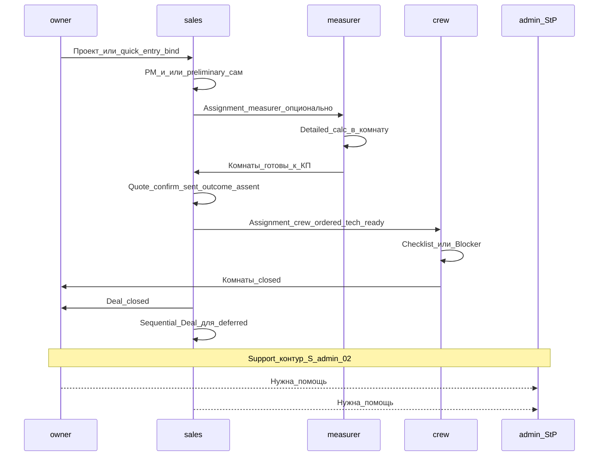

# D2a — Матрица ответственности и handoff

**Revision:** `rev-gate-a-approved-20261022`  
**Зависит от:** [D2](./02-role-scenarios.md)  
**Статус Gate A:** согласован **условно** ([ADR-008](./adr/008-deal-quote-project-identity.md)).

Обозначения RACI: **R** — исполняет, **A** — утверждает / несёт итог, **C** — консультирует, **I** — информируется.  
Платформа одна; колонки — роли, не отдельные продукты.

Согласовано с D2: sales **сам** может PM и preliminary; sales — detailed при разрешении; measurer — основной на detailed; crew — чек-лист и blockers; owner создаёт staff.

---

## 1. Доменные зоны

| Зона | admin StP | owner | sales | measurer | crew |
|------|-----------|-------|-------|----------|------|
| Сеть партнёров, сигналы, materials write | **A/R** | I | I | I | I |
| Org: прайс, город, бренд в PDF | C (defaults сети) | **A/R** | I | I | I |
| Staff компании (создание / сброс credentials) | I | **A/R** | — (только assign) | I | I |
| Создание проекта / quick-entry bind | — | **A**/R | **R** | **R** (с поля / bind) | — |
| PM (диагностика) в комнату | — | A / R | **R** | **R** | I (читает) |
| Calc **preliminary** save | — | A / R | **R** | **R** | — |
| Calc **detailed** save | — | A | **R** при разрешении / C | **R** | — (нет persist) |
| Сделка / КП / confirm_sent / outcome / early decline | I (агрегаты) | **A** | **R** | I | — |
| Partial assent + sequential следующая Deal | — | A | **R** | I | I (видит только ordered) |
| Tech-ready комнаты перед install | — | A | **R** (проверка) | **R** (detailed) | I |
| Assignments sales/measurer/crew | — | A | **R** | C | C |
| Монтаж: чек-лист, blockers, close | — | A | C | I | **R** |
| Снятие blocker (схема/материалы/ответ) | — | A / R | **R** | R (схема/calc) | I |
| Закрытие Deal | I | **A** | **R** | — | — |
| Академия (прохождение) | C (контент) | I | **R** | **R** | **R** |
| Запрос помощи StP | **A** (разбор) | R | R | R | R |
| Аналитика компании (продажи) | I | **A**/R | R (свой срез) | I | I |
| Аналитика training (отдельно) | **A**/R сеть | I | I | I | I |
| Аналитика сети / контур StP | **A**/R | I | — | — | — |

«—» = вне роли (нет экрана / нет права в целевой IA).

**Утверждено:** owner = A/R на создание сотрудников и сброс credentials; sales — только назначения (не create staff). Admin — без delete чужих проектов; агрегаты + ограниченная диагностика.

Пароли: **однократная** выдача временных credentials + безопасный сброс; регулярный просмотр действующих паролей запрещён.

---

## 1a. Три слоя полномочий (не смешивать)

| Слой | Смысл | Пример |
|------|-------|--------|
| **Право на действие** | Может сам выполнить работу в UI | Sales **может** открыть PM и сохранить preliminary |
| **Назначение ответственного** | Кого система считает исполнителем этапа в inbox | Sales назначает measurer на замер, даже если сам мог сделать preliminary |
| **Полномочие завершить этап** | Кто имеет право поставить терминальный статус этапа | confirm_sent и outcome — sales/owner; closed комнаты — crew; Deal closed — sales при A owner |

Следствия:

- Sales не обязан назначать себя, чтобы сделать PM/preliminary — право на действие есть у роли.  
- Назначение measurer **не отбирает** у sales право считать preliminary.  
- Crew не получает полномочие outcome; sales не получает полномочие «закрыть монтаж за бригаду» без ruling (по умолчанию нет).

---

## 2. Handoff-карта

| Handoff | Триггер | Артефакт передачи | Критерий «принято» |
|---------|---------|-------------------|--------------------|
| Owner/Sales → Measurer | Assignment + комнаты | projectId, roomIds | Inbox measurer |
| Sales (self) → Sales | PM/preliminary сохранены | profile / preliminary | Готовность к detailed или ориентировочному КП |
| Measurer → Sales | Detailed и/или профиль | documents | Next action «Сформировать КП»; вклад в tech-ready |
| Sales → Client | Share / отправка | QuoteRevision | confirm_sent (способ передачи; телефон/адрес не всегда) |
| Client → Sales | Ответ / ранний отказ | outcome + roomAssent + lossReason (+ stage) | Сделка не «висит»; StP видит потери |
| Sales/Owner → Crew | accepted + ordered + **tech-ready** + crewUserId | detailed/схема + техсмета + чек-лист | Inbox crew |
| Crew → Sales/Owner | blocker | RoomBlocker | Next action снять причину |
| Crew → Sales/Owner | room closed | status + checklist | Можно закрыть Deal когда ordered закрыты |
| Sales → Sales (повторный заказ) | Deal closed + deferred | **новый dealId** sequential Deal | deferred→ordered; Quote на новой Deal; Project не Done автоматом |
| Any → StP | Support | module context | Case + контур проверки применения |

---

## 3. Что нельзя «размазать» по ролям

| Антипаттерн | Почему ломает | Правило |
|-------------|---------------|---------|
| Пять копий ObjectsPanel | Одинаковые функции, разная обёртка | Один экран + RBAC |
| Crew ведёт КП | Путает исполнение и продажу | Crew без quote/outcome |
| Measurer confirm_sent | Нет владения обещанием клиенту | confirm_sent — sales/owner |
| «Только measurer может PM» | Ломает консультацию менеджера | Sales имеет право PM + preliminary |
| Admin как полевой CRM | Ломает org-изоляцию | Admin — сеть и помощь |
| Авто-accepted при closed | Ruling SDD | Outcome только явно |
| Суммировать preliminary+detailed одной комнаты | Двойной учёт | ADR-005 |
| Training в конверсии Deal | Искажает StP-аналитику | Отдельный контур |
| Install без tech-ready / только preliminary | Бригада без схемы/материалов | D1 §5.6; S-x-03 |
| Перепись sent Quote живым calc | Ломает обещание клиенту | ADR-004 immutability |
| Параллельные активные Deal | Путает UX v1 | Одна активная + sequential |
| Регулярный просмотр паролей staff | Риск безопасности | One-time credentials + reset |

---

## 4. Доступ к деньгам и документам (продуктовый уровень)

| Артефакт | admin | owner | sales | measurer | crew |
|----------|-------|-------|-------|----------|------|
| Смета PDF / detailed (техсмета с ценами org) | ограниченная диагностика | да | да | да | **да** (не клиентское КП) |
| Preliminary estimate | — | да | да | да | read если приложен (редко нужен) |
| Суммы Quote / коммерческий итог проекта | агрегаты сети | да | да | по необходимости read | **нет** |
| Профиль PM | — | да | да | да | да (если приложен) |
| Чек-лист / blockers | — | да | да | да (схема) | **да** |
| Прайс org edit | defaults сети | **да** | нет | нет | нет |
| Действующие пароли staff | — | только one-time при create/reset | нет | нет | нет |

Целевое правило: **техсмета для монтажа видима crew; quote amount / коммерческий итог проекта / outcome — нет**.

---

## 5. Матрица «экран ↔ роль» (home focus)

| Экран / зона | admin | owner | sales | measurer | crew |
|--------------|:-----:|:-----:|:-----:|:--------:|:----:|
| Сеть / партнёры / контур StP | ● home | — | — | — | — |
| Inbox next actions | сигналы | ● | ● home | ● home | ● home |
| Список проектов | агрегаты / диагн.* | ● | ● | свои | назначенные |
| Проект / комнаты | огр. диагностика* | ● | ● | ● | ● limited |
| Сделка / КП / assent | — | ● | ● | — | — |
| Quick-entry / bind | — | ● | ● | ● | — |
| Компания / staff | — | ● create/reset | assign only | — | — |
| Инструменты PM/Calc | secondary | ● | ● (PM+prelim; detailed по праву) | ● | secondary no persist |
| Комната: чек-лист / blocker | — | ● | ● | ● | ● home path |
| Академия / материалы | ● write | ● | ● | ● | ● |
| Помощь StP | inbox cases | CTA | CTA | CTA | CTA |

\*Admin: агрегаты + ограниченная диагностика; **без delete** чужих проектов; не полевой CRM.

● = в регулярной работе роли.

---

## 6. Связь со сценариями

Полные сценарии: [02-role-scenarios.md](./02-role-scenarios.md).  
Навигация: [03-information-architecture.md](./03-information-architecture.md).  
SoT коммерции: [ADR-004](./adr/004-deal-separate-from-room-status.md).
