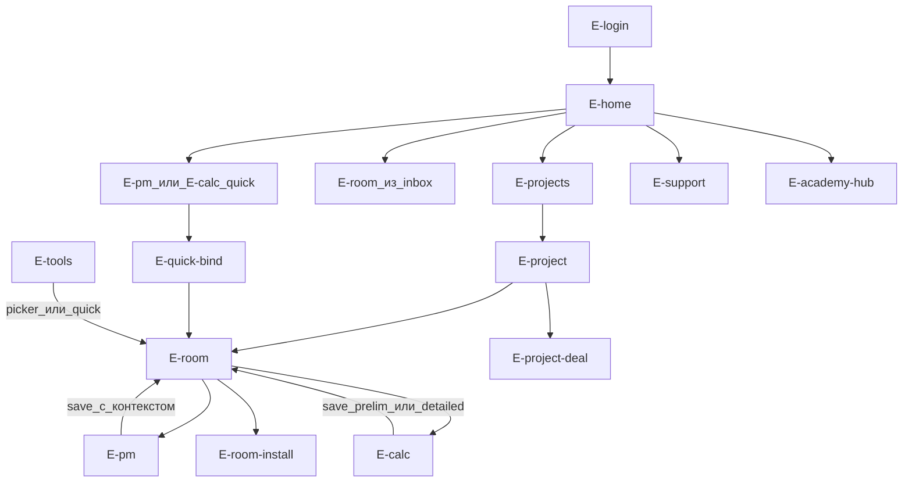
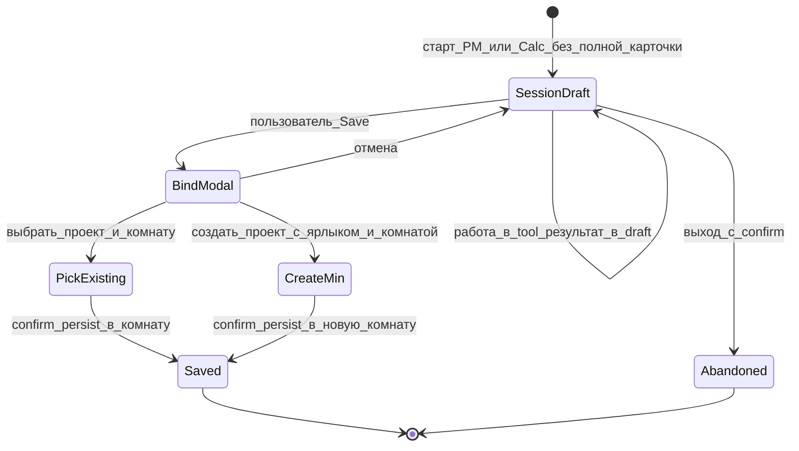
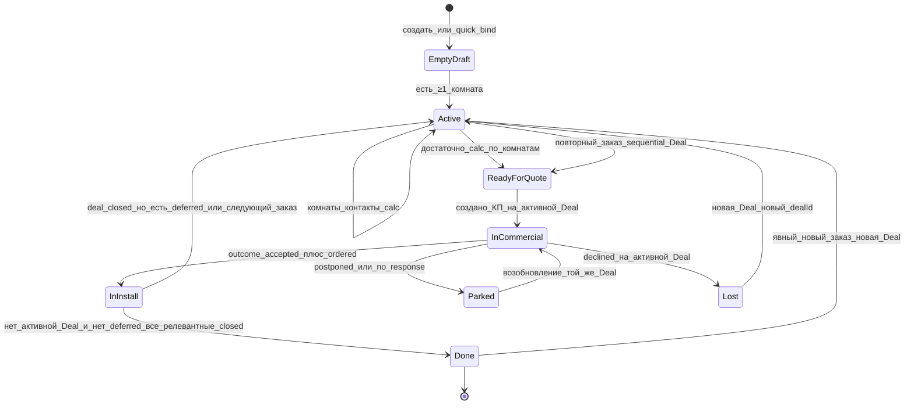
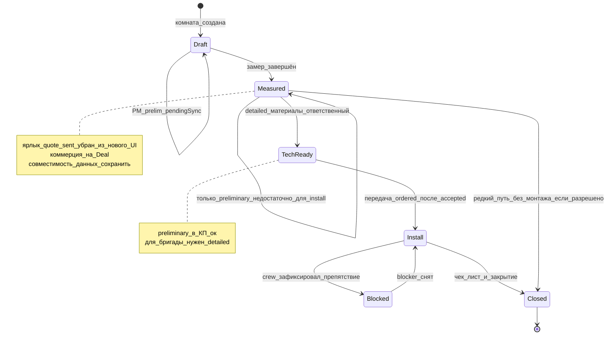
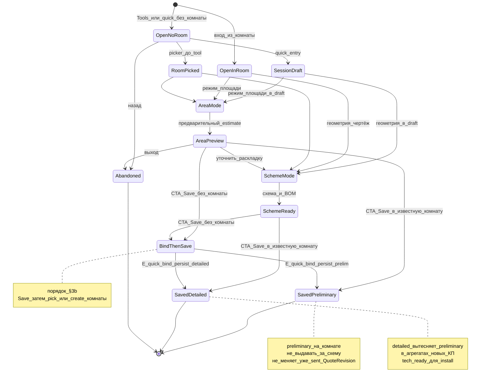
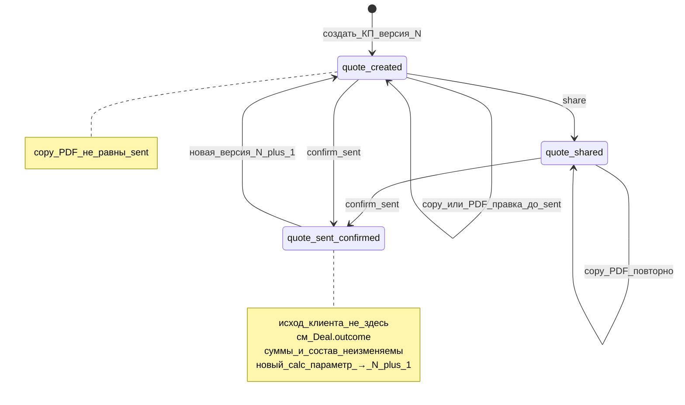
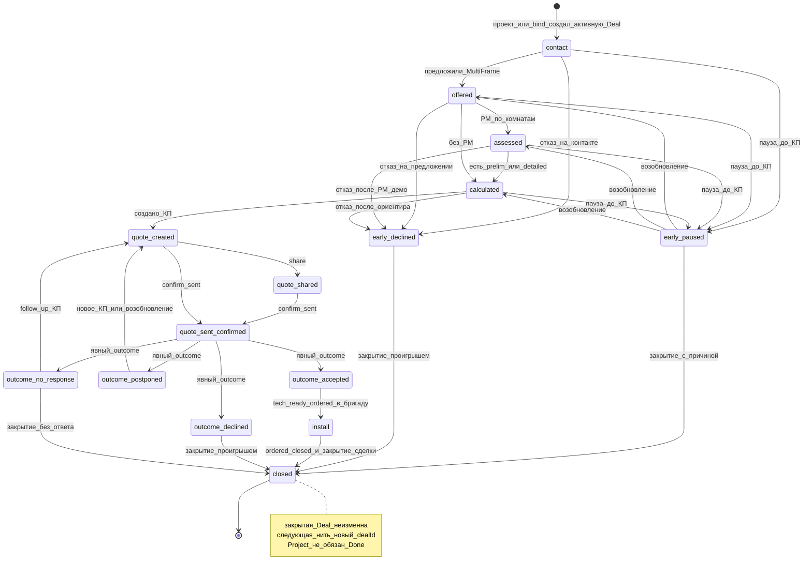

# D3 — Информационная архитектура

**Revision:** `rev-gate-a-approved-20261022`  
**Зависит от:** [D2](./02-role-scenarios.md), [D2a](./02a-responsibility-matrix.md)  
**Статус Gate A:** согласован **условно** (три корректировки — [ADR-008](./adr/008-deal-quote-project-identity.md)).

**Граница:** ниже — продуктовая логика и **пользовательские** переходы. Техконтракты API/полей — Gate B / D5, не дублировать здесь как спеку API.

---

## 1. Навигационный каркас (одна платформа)

```text
[ Chrome: компания · роль · sync · профиль ]
[ Nav по зоне роли ]     [ Workspace: один активный экран ]
```

| Зона nav | admin | owner | sales | measurer | crew |
|----------|-------|-------|-------|----------|------|
| Сегодня / Inbox | Сигналы | Сегодня | Сегодня | Мои замеры | Мои задания |
| Основной каталог | Партнёры | Проекты | Проекты / Сделки* | Проекты (свои) | Задания (= комнаты install) |
| Организация | — | Компания, Сотрудники | Сотрудники (assign) | — | — |
| Аналитика | Сеть (+ training отдельно) | Компания | Компания | — | — |
| Инструменты | secondary | да | да (+ quick-entry) | да | secondary† |
| Обучение | Материалы + Академия | то же | то же | то же | то же |

\*У sales «Сделки» — **фильтр/фокус** над теми же проектами, не второй каталог сущностей.

†**Crew / Tools:** просмотр схемы как help; **persist сметы** нет.

**Admin / каталог проектов:** PartnerCard / support / **агрегаты + ограниченная диагностика**; **без delete** чужих проектов; не полевой CRM.

**Запрет:** стек Inbox + каталог + CommercialPanel + EntryPoints на одном route (ADR-003).

---

## 2. Карта экранов

### 2.1 Глобальные

| ID | Экран | Назначение | Входы |
|----|-------|------------|-------|
| E-login | Вход | Auth / демо-роли | URL |
| E-home | Home роли | Inbox + CTA (новый проект / quick-entry / из сегодня) | после login |
| E-tools | Инструменты | PM / Calc с контекстом или quick-entry | nav |
| E-quick-bind | Привязка после tool | Выбрать/создать проект+комнату перед persist | Save из session draft |
| E-academy-hub | Академия | Хаб механик | Обучение |
| E-materials | Материалы | Библиотека STP | Обучение |
| E-help-cabinet | Справка | Как работать в IA | Обучение |
| E-support | Помощь StP | Case + контекст модуля | CTA |
| E-pm | Проблемомер | Диагностика → save/bind | комната / quick / tools |
| E-calc | Калькулятор | Preliminary или detailed → save/bind | комната / quick / tools |

### 2.2 Проект и комната

| ID | Экран | Назначение |
|----|-------|------------|
| E-projects | Список проектов | Поиск, фильтры, создание |
| E-project | Карточка проекта | Комнаты, итог (анти-двойной учёт), вкладки |
| E-project-deal | Проект → Сделка | Assignments, КП, outcome, roomAssent |
| E-room | Карточка комнаты | Статус, preliminary/detailed, CTA, чек-лист/блокеры |
| E-room-docs | Документы комнаты | Смета / профиль / версии |
| E-room-install | Монтаж комнаты | Чек-лист P0, blockers, close |

Иерархия **Проект → Комнаты** — канон ([ADR-002](./adr/002-project-rooms-over-objects-panel-first.md)).

### 2.3 Организация и сеть

| ID | Экран | Роли |
|----|-------|------|
| E-org | Компания / прайс | owner |
| E-staff | Сотрудники | owner (create/reset credentials); sales — assign only |
| E-partners | Партнёры сети | admin |
| E-partner-card | Карточка / сигналы / контур помощи | admin |
| E-analytics | Дашборд продаж | admin сеть; owner/sales компания |
| E-analytics-training | Срез обучения | admin (отдельно от конверсии) |

### 2.4 Переходы (пользовательские)



---

## 3. Иерархия Проект → Комнаты (UX-правила)

1. Список верхнего уровня — **проекты**.  
2. Внутри — **комнаты** со статусом исполнения и индикаторами preliminary / detailed / профиль.  
3. Предварительный итог проекта: на комнату берётся **detailed, иначе preliminary** (с пометкой); **запрет** складывать оба. Подпись: «не зафиксированное КП».  
4. Создание: «Новый проект» (≥1 комната) или quick-entry → bind/create.  
5. Запрещён плоский список «объектов» как главная модель.  
6. Канбан — опциональное представление, якорь — проект.

---

## 3a. Точки входа в работу

1. **Новый клиент (полные данные)** → проект+комната → PM/Calc.  
2. **Продолжить комнату** → inbox / проект.  
3. **Quick-entry** → PM/Calc без адреса/телефона → **E-quick-bind** при save ([ADR-007](./adr/007-quick-entry-without-full-client-card.md)).  
4. «Консультация» ≈ кабинетный PM-путь; отдельный visitor-путь сайта не дублировать тремя виджетами на home.

EntryPoints-стек на home — убрать (ADR-003). CTA home: «Новый проект», «Быстрая консультация», «Быстрый расчёт», «Открыть из сегодня».

---

## 3b. Quick-entry bind (UX)

**Основной порядок:** открыть инструмент → получить результат → Save → выбрать/создать комнату → confirm persist.



Правила: bind **после** результата и Save, не до расчёта; нет безымянных проектов; повторный save того же draft → та же комната; телефон/адрес можно дополнить на E-project позже (до confirm_sent достаточно способа передачи КП — см. review §8).

---

## 4. Академия и аналитика StP в IA

### 4.1 Академия

```text
E-academy-hub
 ├─ Продажи и возражения → чат-симуляции  ← приоритет v1
 ├─ Расчёты и практика замера → не-чат     ← далее
 └─ Монтаж → не-чат (в т.ч. чеклист-симуляция) ← далее
```

`context: training` ∉ KPI продаж; отдельный срез E-analytics-training.

### 4.2 Контур StP (продуктовая аналитика)

На E-partner-card / E-analytics (не отдельный «пятый кабинет»):

1. Сигнал затруднения  
2. Диагностика  
3. Обращение / действие StP  
4. Проверка применения инструментов  
5. Оценка последующих результатов (Deal.outcome)  

Сценарий: S-admin-02. Деталь метрик — D10 (Gate B).

---

## 5. State diagrams (продукт / UX)

Ниже — состояния для пользователя. Не JSON-схемы.  
**SoT коммерции:** [ADR-004](./adr/004-deal-separate-from-room-status.md).

### 5.0 Сводка SoT vs производное

| Состояние | SoT? | Где живёт |
|-----------|------|-----------|
| Deal.outcome | **да** | Deal |
| Deal.stage | **да** | Deal |
| Deal.roomAssent | **да** | Deal |
| QuoteRevision.lifecycle (created/shared/sent_confirmed) | **да** (документ) | Quote |
| Project UX: ReadyForQuote / InCommercial / … | **нет** — производное | UI от Deal + rooms |
| Room.status | **да** (исполнение) | Room |
| Room blocker / checklist | **да** (операционка) | Room |
| Конверсия | **Deal.outcome=accepted** | аналитика |

### 5.1 Project (UX-жизненный цикл — производные фазы)



`ReadyForQuote` / `InCommercial` / `Done` — **индикаторы UI**, не параллельный SoT исхода. Исход — только Deal.outcome.  
**Закрытие одной Deal ≠ Project Done**, если есть deferred-комнаты или последующие заказы ([ADR-008](./adr/008-deal-quote-project-identity.md)).

### 5.2 Room (исполнение)



Чек-лист монтажа — часть состояния Install (P0), обязателен; N/A с причиной; исключения waive — Gate B.

### 5.3 Calculation (два типа → комната)

Порядок quick-entry совпадает с §3b: **результат → Save → bind → persist** (не bind до расчёта).



Стены: WallMode **не** в основном пути.  
Агрегация: per room `coalesce(detailed, preliminary)`; никогда `preliminary + detailed`.  
Изменение calc комнаты **не** переписывает суммы уже `sent_confirmed` QuoteRevision — нужна новая версия (§5.4, ADR-004).

### 5.4 Quote (lifecycle **документа**; без accept/decline)



Версии: каждая N+1 = **новый экземпляр** документа, привязанный к **конкретной активной Deal** (`dealId` обязателен). После `sent_confirmed` экземпляр **immutable**. Новые параметры calc → N+1 на **той же** Deal, не patch sent и не «переезд» на другую Deal. Деталь snapshot — Gate B / D5 ([ADR-008](./adr/008-deal-quote-project-identity.md)).

### 5.5 Deal (воронка + outcome = SoT исхода)

Ранние отказы/паузы **до КП** обязательны: иначе StP не видит потери на консультации/демо.



Правила:

- Одна **активная** Deal на проект; после `closed` — **новый `dealId`** (sequential) в том же проекте; закрытая Deal **не reopen**. Параллельный multi-order UI **нет**.  
- Переход UX «снова contact» = **create** новой Deal, не возврат старой в `contact` ([ADR-008](./adr/008-deal-quote-project-identity.md)).  
- Ранний исход (`early_declined` / `early_paused`) требует **причину** и **этап** воронки.  
- `outcome_accepted` допускает partial assent (не все комнаты ordered).  
- Передача в install — только после `accepted` **и** tech-ready — D1 §5.6 / D2 S-x-03.  
- Система **не** ставит outcome из `room.closed`.  
- Успешная продажа ≠ завершённый монтаж; **закрытие Deal ≠ завершение Project** при deferred / следующих заказах.  
- Конверсия = `Deal.outcome=accepted` **по dealId**; отдельно — сумма принятого заказа.

Согласование Quote↔Deal: confirm_sent двигает lifecycle документа **этой** Deal + stage; **исход** только на Deal; на Quote нет accept/decline.

---

## 6. «Следующий шаг» как паттерн UI

| Контекст | Плохой next step | Целевой next step |
|----------|------------------|-------------------|
| PM Result в кабинете | Только заявка StP | Сохранить в комнату · Рассчитать · Bind · К проекту |
| Home sales | «Проблемомер» без проекта | Проект X · Quick-entry · Confirm sent · Outcome |
| Home measurer | Общий Tools | Продолжить комнату Y · Detailed save |
| Home crew | PM/Calc primary | Монтаж Z · Чек-лист · Зафиксировать препятствие |
| Calc area | «Объект сохранён» как схема | «Сохранён предварительный» / «постройте схему для detailed» |
| Admin сигнал | Только открыть чат Академии | Диагностика → intervention → проверка применения |

---

## 7. Mobile / desktop акцент

| Роль | Primary viewport |
|------|------------------|
| measurer, crew | Mobile: inbox → room → tool/checklist → back |
| sales, owner | Desktop: projects + deal; mobile — те же сущности |
| admin | Desktop сеть + контур помощи |

---

## 8. Соответствие текущему коду (аудит → цель)

| Сейчас | Цель Gate A (`rev-gate-a-final-candidate`) |
|--------|------------------------|
| ObjectsPanel = главный workspace | E-projects / E-project / E-room |
| SalesHome стек 4 блоков | E-home **или** E-project-deal |
| ProjectsCabinet orphan | Влить в E-project |
| JobObject.status quote_sent | Убрать из нового UI; SoT на Deal; совместимость данных |
| Area не сохраняется | Preliminary save в комнату |
| EntryPoints без контекста | Quick-entry: tool → result → Save → bind → persist |
| Academy = 2 chat | Hub + тренажёры продаж сначала; не-чат далее |
| Нет чек-листа / blockers | E-room-install P0; tech-ready до install |
| Quote accept на диаграмме draft-1 | Исход только Deal.outcome; early decline до КП |
| Живой пересчёт sent КП | Immutable sent QuoteRevision → N+1 |
| Один Deal навсегда / parallel multi-order | Sequential следующая Deal после closed |

---

## Связанные документы

- [01-product-architecture.md](./01-product-architecture.md)  
- [adr/](./adr/)  
- [gate-a-review.md](./gate-a-review.md)  
- [gate-a-changelog-draft-1-to-2.md](./gate-a-changelog-draft-1-to-2.md)
