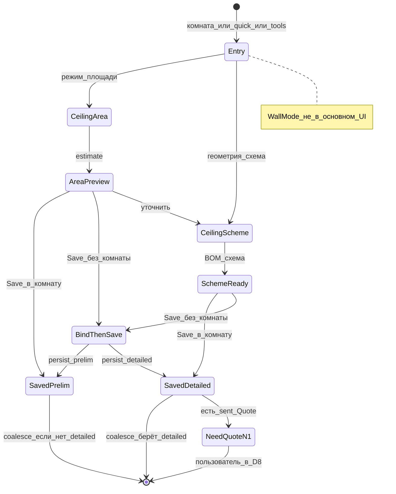

# D7 — Калькулятор для потолочников (кабинет)

**Revision:** `rev-gate-b-draft-1`  
**Gate:** B (черновик)  
**Зависит от:** [D1](./01-product-architecture.md), [D3](./03-information-architecture.md), [ADR-005](./adr/005-ceiling-segment-presets-pm-calc.md), [ADR-007](./adr/007-quick-entry-without-full-client-card.md), [ADR-004](./adr/004-deal-separate-from-room-status.md), [ADR-008](./adr/008-deal-quote-project-identity.md)  
**Связь:** [D6](./06-probleмомер-ceiling.md) (опциональный вход), [D8](./08-commercial-process.md) (КП)  
**Статус:** черновик Gate B; **продукт/UX только** — алгоритмы раскладки и wall-* **не меняем**.

---

## 0. Назначение и границы

| Внутри D7 | Вне / запрещено |
|-----------|-----------------|
| UX режимов **preliminary** (площадь) и **detailed** (геометрия+схема+BOM) | Правка геометрических алгоритмов раскладки |
| Save в комнату; quick-entry bind; история сохранений; anti-loss | Удаление wall-* кода |
| Стены **вне основного UI** сегмента потолочников | Выдавать area-estimate за схему |
| Связь с КП: sent immutable → N+1 | Живой пересчёт уже `sent_confirmed` QuoteRevision |
| Анти-двойной учёт `coalesce(detailed, preliminary)` | Суммировать оба типа одной комнаты |

**Ядро:** существующий calculator + postMessage `mf-cabinet-calc` — ориентир интеграции; целевой продукт описывает **поведение**, не обязывает сохранить iframe forever (**Assumption:** host может эволюционировать; контракт save — канон).

---

## 1. Два типа расчёта у комнаты

| Тип | Вход пользователя | Что persist | Назначение | Tech-ready? |
|-----|-------------------|-------------|------------|-------------|
| **preliminary** | Площадь (+ опц. простые параметры / прайс org) | Estimate по площади; **без** схемы раскладки и BOM-схемы | Консультация, ориентир, ранний черновик КП | **Нет** |
| **detailed** | Геометрия / чертёж → схема + спецификация | Схема, BOM, document estimate со схемой, PDF сметы | Точная смета, монтаж, основное КП | **Да** (вместе с материалами + ответственный — D1 §5.6) |

**Сосуществование:** на комнате могут быть оба слота. UI бейджи: «Предварительно» / «Со схемой».  
**Агрегация (обязательно):**

```text
roomContribution = coalesce(detailed, preliminary)
projectTotal = Σ roomContribution по комнатам (с учётом состава КП / roomAssent)
НИКОГДА: preliminary.amount + detailed.amount одной комнаты
```

Подпись в итоге проекта: если взяли preliminary — «ориентир, не схема».  
Если есть detailed — preliminary **не** входит в сумму новых КП / аналитики сумм (остаётся в истории комнаты).

---

## 2. Стены — вне основного UI

| Правило | Деталь |
|---------|--------|
| Основной путь потолочников | Только потолок / площадь потолка / схема потолка |
| Выбор «стена» / wall-режимы | Не показывать в main nav, Start calc, primary mode switcher |
| Код `wall-*` | **Не удалять**; доступен другим сегментам / future / hidden flag |
| **Assumption** | Escape hatch «расширенный режим» для rare cases — не в P0 UI; требует отдельного OK |

---

## 3. Кто может что

| Действие | sales | owner | measurer | crew |
|----------|-------|-------|----------|------|
| Открыть calc (просмотр) | да | да | да | схема help, **без** persist сметы |
| Save **preliminary** | **R** | **R** | **R** | нет |
| Save **detailed** | **R при разрешении** (S-sales-07) | A / R | **R** (основной) | нет |
| Bind quick-entry | да | да | да | нет |

---

## 4. Сценарии

### S-calc-01 — Preliminary из комнаты

| Поле | Содержание |
|------|------------|
| **Начало** | Комната открыта; нужна ориентировочная сумма по площади. |
| **Результат** | `calculation.preliminary` на комнате; итог проекта обновлён по coalesce; бейдж «предварительно». |
| **User** | «Рассчитать» → режим площади → ввод м² → превью estimate → **«Сохранить предварительный расчёт в эту комнату»**. |
| **System** | Пишет только preliminary-слот; **не** помечает room как detailed/tech-ready; если detailed уже есть — показывает оба, в сумме использует detailed; Deal.stage → `calculated` при первом usable calc (**Assumption:** авто-stage). |
| **Состояния** | AreaMode → AreaPreview → SavedPreliminary (D3 §5.3). |
| **Данные** | areaM2, panels/dowels estimate (если модель даёт), costs по OrgSettings, savedAt, savedBy. |
| **Ошибки** | Площадь ≤ 0 → валидация; сеть → retry/outbox; попытка CTA «смета со схемой» на area-only → блок + направление в detailed. |
| **AC** | После save — та же комната; копирайт не называет это «схемой»; preliminary ≠ tech-ready. |

### S-calc-02 — Detailed из комнаты (measurer / sales с правом)

| Поле | Содержание |
|------|------------|
| **Начало** | Замер/чертёж; нужна смета со схемой. |
| **Результат** | `calculation.detailed` + document; вклад в tech-ready; **уже sent** QuoteRevision **не** меняется. |
| **User** | Calc → геометрия/чертёж → схема+BOM → **«Сохранить расчёт (со схемой) в эту комнату»**. |
| **System** | Persist detailed; PDF сметы (техсмета с ценами); агрегат проекта берёт detailed; если есть `sent_confirmed` на активной Deal — toast/баннер: «Отправленное КП не обновлено — создайте версию N+1» (ссылка в D8). |
| **Состояния** | SchemeMode → SchemeReady → SavedDetailed. |
| **Данные** | geometry, scheme, BOM, estimate, pdf refs, savedAt/By. |
| **Ошибки** | Нет права detailed у sales → блок + предложить measurer; save без комнаты → picker; алгоритм/схема failed → error, draft не терять. |
| **AC** | roomId стабилен; sent Quote amounts неизменны; в итоге нет double-count. |

### S-calc-03 — Quick-entry «Быстрый расчёт»

| Поле | Содержание |
|------|------------|
| **Начало** | Нет полной карточки; нужен ориентир по площади (чаще) или схема. |
| **Результат** | Calc сохранён в выбранную/созданную комнату; нет orphan. |
| **User** | Home «Быстрый расчёт» → tool → результат → **Save** → E-quick-bind → confirm. |
| **System** | Session draft; bind **после** Save ([ADR-007](./adr/007-quick-entry-without-full-client-card.md)); тип save = preliminary или detailed по режиму. |
| **Ошибки** | Save без bind → модалка; discard с confirm. |
| **AC** | После persist projectId+roomId+читаемое имя; повторный Save draft → та же комната. |

### S-calc-04 — Переход preliminary → detailed

| Поле | Содержание |
|------|------------|
| **Начало** | На комнате есть preliminary; клиент готов к точному замеру. |
| **Результат** | Detailed сохранён; preliminary остаётся в истории слота; агрегат = detailed. |
| **User** | Из AreaPreview «Уточнить раскладку» **или** из комнаты «Построить схему». |
| **System** | Не удаляет preliminary молча; UI показывает оба; coalesce переключается на detailed. |
| **AC** | Сумма проекта не равна sum(both). |

### S-calc-05 — История сохранений и anti-loss

| Поле | Содержание |
|------|------------|
| **Начало** | Пользователь пересчитывает / правит; риск потерять прошлый ориентир. |
| **Результат** | Видна история save; уход без Save не молча теряет draft. |
| **User** | Комната → «История расчётов» (или блок на E-room-docs); при выходе из calc с грязным draft — confirm. |
| **System** | Каждое успешное Save = запись в истории слота (тип, at, by, amount/summary); текущий слот = latest; **Assumption:** хранить ≥5 последних save на слот или 30 дней (что раньше исчерпается) — порог не утверждён. |
| **Ошибки** | Crash mid-edit → восстановить session draft при возврате в tool с тем же roomId. |
| **AC** | Нельзя потерять последний успешный persist без явного overwrite confirm при конфликте версий (**Assumption:** last-write-wins + warning, если remote newer). |

### S-calc-06 — Связь с КП после пересчёта

| Поле | Содержание |
|------|------------|
| **Начало** | На активной Deal есть QuoteRevision в `sent_confirmed`; calc комнаты изменили. |
| **Результат** | Sent revision **immutable**; пользователь создаёт N+1 на **той же** Deal (`dealId` обязателен) — D8. |
| **User** | Баннер на комнате/сделке → «Создать новую версию КП». |
| **System** | Запрет patch sent; новые суммы только в N+1 snapshot. |
| **AC** | Сравнение: sent.amount ≠ live room aggregate не «чинит» sent автоматически. |

---

## 5. Save UX (канон)

```text
Результат в tool
  → явный CTA Save (тип: предварительный | со схемой)
    → если room известен: confirm «в комнату «X» проекта «Y»»
    → если нет: E-quick-bind → pick/create → confirm persist
  → success: возврат в E-room (предпочтительно) или остаёмся с toast + «К комнате»
```

**Запрещено:** silent create объекта без имени/проекта; save в «первый попавшийся» project; выдавать area-save как detailed; auto-overwrite sent Quote.

**Anti-loss черновика:**

- Dirty session → confirm on back/close.  
- Offline: local draft + pendingSync на комнате после bind.  
- Повторный postMessage того же save → идемпотентность по draftId (**Assumption:** draftId в session; деталь D5).

---

## 6. State diagram (UX calc — потолочники)



---

## 7. Loading / error / empty

| Состояние | Поведение |
|-----------|-----------|
| Счёт / раскладка | Progress в tool; не закрывать dirty без confirm |
| Пустая площадь | CTA Save disabled + «укажите площадь» |
| Нет схемы при detailed CTA | Disabled / блок |
| Org без прайса | Estimate qty ok; costs null + предупреждение «цены в компании» |
| Crew открыл calc | Read-only схема; Persist скрыт |
| Double-count attempt в UI КП | Блок на уровне D8 + этот документ как правило источника |

---

## 8. Критерии приёмки

| ID | Критерий | Проверка |
|----|----------|----------|
| AC-D7-01 | В основном UI нет выбора «стена» | Навигация calc потолочников |
| AC-D7-02 | wall-* код присутствует в репозитории | Grep/CI sanity (не удалять) |
| AC-D7-03 | Preliminary save пишет слот и **не** ставит tech-ready | Room flags |
| AC-D7-04 | Detailed save пишет схему+BOM; PDF сметы доступен | E-room-docs |
| AC-D7-05 | `projectTotal` использует coalesce, не сумму обоих | Фикстура: room с обоими → одна сумма |
| AC-D7-06 | Quick-entry: Save→bind→persist; нет orphan | S-calc-03 |
| AC-D7-07 | История: ≥1 прошлый save виден после второго Save | UI |
| AC-D7-08 | Dirty exit → confirm | Ручной |
| AC-D7-09 | После изменения calc sent Quote не меняется | Сравнение revision snapshot |
| AC-D7-10 | Sales без права detailed не persist схему | RBAC |
| AC-D7-11 | Возврат после Save — исходная комната | deep-link roomId |

---

## 9. Assumptions

1. Авто-advance Deal.stage → `calculated` при первом usable calc.  
2. Глубина истории save (N или дни) — порог в D5.  
3. Conflict resolution last-write-wins + warning.  
4. Host calc (iframe vs in-app) может смениться; контракт Save/типов — стабилен.  
5. Escape hatch стен — не P0.  
6. Точные лейблы кнопок — D4; смысл CTA здесь каноничен.

---

## Связанные документы

- [01-product-architecture.md](./01-product-architecture.md) §5.2  
- [03-information-architecture.md](./03-information-architecture.md) §5.3  
- [adr/005-ceiling-segment-presets-pm-calc.md](./adr/005-ceiling-segment-presets-pm-calc.md)  
- [08-commercial-process.md](./08-commercial-process.md)  
- [gate-a-review.md](./gate-a-review.md)
