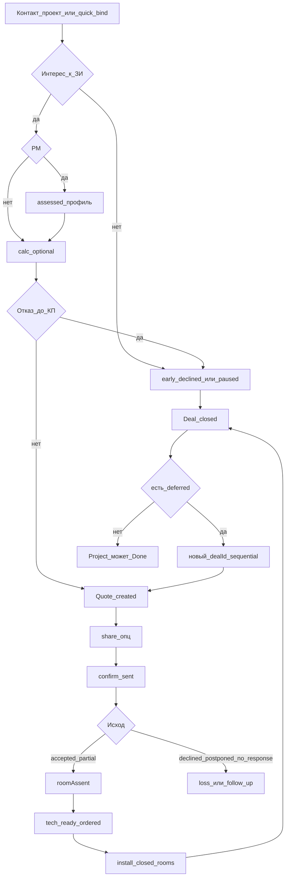

# D8 — Коммерческий процесс (Deal / КП / исходы)

**Revision:** `rev-gate-b-draft-1`  
**Gate:** B (черновик)  
**Зависит от:** [D1](./01-product-architecture.md), [D3](./03-information-architecture.md), [ADR-004](./adr/004-deal-separate-from-room-status.md), [ADR-008](./adr/008-deal-quote-project-identity.md), [ADR-005](./adr/005-ceiling-segment-presets-pm-calc.md), [ADR-007](./adr/007-quick-entry-without-full-client-card.md)  
**Связь:** [D6](./06-probleмомер-ceiling.md), [D7](./07-calculator-ceiling.md), [D2](./02-role-scenarios.md)  
**Статус:** черновик Gate B. Поля snapshot Quote — принцип здесь; JSON/API — D5.

---

## 0. Источники истины (не нарушать)

| Вопрос | SoT | Запрещено |
|--------|-----|-----------|
| Исход продажи / отказ / пауза | **Deal.outcome** (+ early_*) | Accept/decline как SoT на Quote |
| Этап воронки | **Deal.stage** (+ stageAtOutcome при early) | Выводить из Room.status |
| Документ КП | **QuoteRevision** lifecycle `created`→`shared`→`sent_confirmed` | copy/PDF = sent |
| После sent | Revision **immutable** | Patch сумм/состава sent |
| N+1 | **Новый экземпляр** на **той же** активной Deal (`dealId` обязателен) | «Переезд» КП на другую Deal |
| После closed Deal | **Новый dealId** (sequential) | Reopen того же id |
| Закрытие Deal | ≠ Project Done при deferred / следующих заказах | Авто-Done из deal_closed |
| Конверсия | `outcome=accepted` по dealId | room.closed; training |
| Сумма заказа | Отдельно от факта accepted | Складывать prelim+detailed одной комнаты |
| Монтаж | accepted + ordered + **tech-ready** | Preliminary-only в бригаду |

§8 / ADR-008 — закон для этого документа.

---

## 1. Модель сущностей (продукт)

```text
Project
 ├─ Rooms[]  (исполнение; calc; profile)
 └─ Deal[]   (история; ровно 1 active)
      └─ active Deal
           ├─ stage, outcome, roomAssent, lossReason, stageAtOutcome
           └─ QuoteRevision[]  (каждая с dealId; sent → immutable)
```

**roomAssent** на комнату в рамках Deal: `ordered` | `deferred` | `out_of_scope`.

**Продуктовые early-исходы** (до КП; обязательны для StP):

| Outcome | Смысл |
|---------|--------|
| `early_declined` | Отказ до создания КП |
| `early_paused` | Пауза до КП (возобновляема) |

**Assumption:** в shared `DealOutcome` сегодня нет early_*; Gate B фиксирует **продукт**, миграция enum — D5. Не подменять early через `declined` без `stageAtOutcome`.

**Quote lifecycle (продукт):** только документ. Accept/decline на Quote в текущем коде — **gap**; целевой UX не показывает исход на КП как SoT.

---

## 2. Карта коммерческих сценариев

| ID | Сценарий | Результат |
|----|----------|-----------|
| S-com-01 | Нет интереса к ЗИ (консультация без calc) | early_declined / early_paused + причина + этап |
| S-com-02 | Консультация с PM, без calc | assessed; далее КП или early_* |
| S-com-03 | Early decline на любом до-КП этапе | Deal closed / early_*; StP видит этап |
| S-com-04 | Предварительное КП (только preliminary) | Quote created→confirm_sent; пометка «ориентир» |
| S-com-05 | Точное КП (detailed / coalesce) | Quote; tech-ready путь после accepted |
| S-com-06 | Multi-room КП | Состав комнат + типы calc на revision |
| S-com-07 | Partial assent | accepted + roomAssent mix |
| S-com-08 | Sequential reorder (новый dealId) | Закрытая Deal неизменна; новая нить |
| S-com-09 | confirm_sent | sent_confirmed; copy≠sent |
| S-com-10 | Loss reasons / postponed / no_response | Outcome + next actions |
| S-com-11 | N+1 после пересчёта / пересмотра | Новый экземпляр на той же Deal |

---

## 3. Сценарии (каркас качества)

### S-com-01 — Нет интереса к ЗИ: консультация без calc

| Поле | Содержание |
|------|------------|
| **Начало** | Клиент за натяжной; MultiFrame предложен устно / коротко; calc не открывали. |
| **Результат** | На активной Deal зафиксирован early-исход с **этапом** (`contact` или `offered`) и **причиной**; проект и комнаты живы. |
| **User** | Проект → Сделка → «Отказ» или «Пауза» → этап → причина (напр. `no_need`) → сохранить. |
| **System** | Пишет Deal.outcome=`early_declined`|`early_paused`, `stageAtOutcome`, `lossReason`; **не** требует Quote; **не** требует calc; при decline → путь к `closed`. |
| **Состояния** | D3 §5.5 early_* |
| **Данные** | Deal.*; Project Active |
| **Ошибки** | Пустая причина/этап → валидация |
| **Ответственные** | Sales R; owner A |
| **AC** | Аналитика воронки показывает потерю **до** quote_created; training-событие не создаёт этот outcome |
| **Next actions** | При pause — «Возобновить»; при decline+closed — «Новая сделка» только если новый заказ (новый dealId) |

### S-com-02 — Консультация с PM без calc

| Поле | Содержание |
|------|------------|
| **Начало** | Провели PM (D6); клиент смотрит профиль; цены ещё нет. |
| **Результат** | Deal на `assessed` (или вручную); либо переход к calc/КП, либо early_*. |
| **User** | После Result PM → сохранить профиль → на сделке продолжает разговор → «Сформировать ориентир» (D7) **или** early_*. |
| **System** | Не блокирует early_* отсутствием calc; не ставит accepted из профиля. |
| **AC** | Можно закрыть интерес на этапе assessed без Quote |

### S-com-03 — Early decline на calculated (есть ориентир, КП не создавали)

| Поле | Содержание |
|------|------------|
| **Начало** | Есть preliminary; клиент: «дорого / не сейчас» — КП не собирали. |
| **Результат** | early_declined|early_paused, stageAtOutcome=`calculated`, lossReason. |
| **User** | Сделка → Отказ/Пауза → причина (`expensive`, `postponed_repair`, …). |
| **System** | Calc на комнате **сохраняется**; Deal закрывается по правилам early decline. |
| **AC** | Потеря видима StP с этапом calculated; данные calc не удаляются |

### S-com-04 — Предварительное КП

| Поле | Содержание |
|------|------------|
| **Начало** | По комнатам только preliminary (или mix, но выбранные — prelim). |
| **Результат** | QuoteRevision N с пометкой «ориентировочно»; lifecycle до `sent_confirmed` по S-com-09. |
| **User** | Сделка → создать КП → выбрать комнаты → видит warning «без схемы» → copy/PDF → confirm_sent. |
| **System** | Сумма комнаты = preliminary; запрет double-count; **не** tech-ready. |
| **Ошибки** | Нет ни одного usable calc → блок; попытка передать в монтаж после accepted без detailed → блок tech-ready |
| **AC** | В UI КП явная пометка предварительности; crew не получает install |

### S-com-05 — Точное КП

| Поле | Содержание |
|------|------------|
| **Начало** | По нужным комнатам есть detailed (или coalesce выбрал detailed). |
| **Результат** | QuoteRevision со snapshot detailed; после accepted возможен путь tech-ready→install. |
| **User** | Создать КП → состав → confirm_sent → outcome. |
| **System** | Snapshot calc на версии (**Assumption:** набор полей snapshot — D5: amounts, roomIds, calcType per room, scheme/doc refs). |
| **AC** | Изменение live detailed после sent не меняет эту revision |

### S-com-06 — Multi-room

| Поле | Содержание |
|------|------------|
| **Начало** | Проект: кухня + гостиная + спальня; разные готовности calc. |
| **Результат** | Одна QuoteRevision перечисляет включённые комнаты; на комнату — один вклад coalesce; отложенные комнаты видны как не в составе **или** deferred в assent позже. |
| **User** | Чекбоксы комнат при создании КП; видит тип calc каждой. |
| **System** | `roomObjectIds[]`; сумма = Σ coalesce; нельзя включить комнату без usable calc. |
| **AC** | Три комнаты с detailed+prelim каждая → в сумме 3 вклада, не 6 |

### S-com-07 — Partial assent

| Поле | Содержание |
|------|------------|
| **Начало** | КП sent; клиент берёт 2 из 3 комнат. |
| **Результат** | `outcome=accepted`; roomAssent: 2×ordered, 1×deferred (или out_of_scope); конверсия = accepted; сумма принятого заказа = сумма ordered. |
| **User** | Сделка → Исход «Согласился» → отмечает комнаты. |
| **System** | Монтажный пул = только ordered + later tech-ready; deferred не в inbox crew; **Deal остаётся** пока ordered не закрыты / сделка не closed по политике. |
| **Ошибки** | Accepted без ни одной ordered → валидация |
| **AC** | Crew не видит deferred; Project не Done |

### S-com-08 — Sequential reorder (новый dealId)

| Поле | Содержание |
|------|------------|
| **Начало** | Первая Deal: accepted partial; ordered смонтированы; Deal **closed**; есть deferred. |
| **Результат** | Создана **новая** Deal с **новым dealId** в том же projectId; закрытая Deal неизменна (outcome/суммы/КП); на новой Deal — deferred→ordered + новая QuoteRevision с **новым** dealId. |
| **User** | Проект → «Новая сделка / дозаказ» → система create Deal (не reopen) → КП на новой нити → … |
| **System** | Запрет reopen; история Deal[] доступна read-only; Project UX Active (не Done). |
| **AC** | Старый dealId не меняет stage/outcome; аналитика конверсии по каждому dealId отдельно; Quote прошлых Deal не «переезжают» |

### S-com-09 — confirm_sent

| Поле | Содержание |
|------|------------|
| **Начало** | QuoteRevision в created или shared; менеджер реально отправил клиенту (WA/email/лично). |
| **Результат** | `lifecycle=sent_confirmed`; `sentConfirmedAt`; Deal.stage → `quote_sent_confirmed`; revision **immutable**. |
| **User** | Явная кнопка **«Подтвердить отправку»** (не copy, не PDF, не share alone). |
| **System** | copy/PDF/share **не** меняют на sent; до confirm достаточно способа передачи (телефон/адрес не всегда обязательны — ADR-007). |
| **Ошибки** | Confirm без способа передачи → **Assumption:** warning, не жёсткий блок, если канал указан в комментарии sentComment |
| **Next actions** | «Зафиксировать ответ клиента» (outcome) |
| **AC** | После только copy UI **не** показывает «КП отправлено» как факт доставки |

### S-com-10 — Исходы после sent + loss reasons

| Поле | Содержание |
|------|------------|
| **Начало** | sent_confirmed; ждём ответ. |
| **Результат** | Явный Deal.outcome. |

| Outcome | Требования | Next actions (примеры) |
|---------|------------|------------------------|
| `accepted` | ≥1 ordered; roomAssent заполнен | Tech-ready checklist → assign crew |
| `declined` | lossReason обязателен | Closed; опц. материалы/обучение; не training KPI |
| `postponed` | опц. nextActionAt | Reminder; можно N+1 / возобновление **той же** Deal |
| `no_response` | опц. nextActionAt | Follow-up; или closed без ответа |

**Справочник причин (продукт; лейблы как в shared):**

| Код | Лейбл |
|-----|-------|
| `expensive` | Дорого |
| `no_need` | Не видит потребности |
| `doubts_efficacy` | Сомневается в эффективности |
| `chose_other` | Выбрал другой вариант |
| `postponed_repair` | Отложил покупку/ремонт |
| `technical` | Нет технической возможности |
| `other` | Другая причина (+ comment) |
| `unknown` | Неизвестно |

Те же коды для early_* (**Assumption:** один справочник).

**AC:** система **не** ставит accepted из room.closed; Quote UI не является местом фиксации исхода.

### S-com-11 — N+1 на той же Deal

| Поле | Содержание |
|------|------------|
| **Начало** | Sent N; изменили calc / состав / цену / пересмотр. |
| **Результат** | Новая QuoteRevision N+1, `dealId` = активная Deal; N остаётся immutable в истории. |
| **User** | «Новая версия КП» → редактирование черновика → снова confirm_sent. |
| **System** | Не patch N; snapshot от актуальных комнат на момент создания N+1. |
| **AC** | Открыть N — суммы старые; N+1 — новые; оба с одним dealId |

---

## 4. Полный коммерческий путь (сквозная лента)



---

## 5. Next actions после ключевых событий

| Событие | Inbox sales/owner |
|---------|-------------------|
| early_paused | Возобновить сделку · Назначить follow-up |
| early_declined → closed | — (история); при новом запросе — новая Deal |
| quote_created | Отправить клиенту · confirm_sent |
| sent_confirmed | Зафиксировать ответ |
| accepted + не tech-ready | Дособрать detailed / материалы / ответственного |
| accepted + tech-ready | Назначить crew |
| blocker от crew | Снять причину |
| Deal closed + deferred | Создать следующую Deal (новый dealId) |
| calc changed + sent exists | Создать КП N+1 |

---

## 6. Согласование с calc / PM

| Правило | Ссылка |
|---------|--------|
| Можно КП без PM | D6 S-pm-03, D1 |
| Можно early_* без calc | S-com-01 |
| Суммы КП = coalesce | D7 / ADR-005 |
| Sent не пересчитывается live calc | ADR-004/008, S-com-11 |
| Preliminary в КП ≠ install | D1 §5.6 |

---

## 7. Критерии приёмки

| ID | Критерий | Проверка |
|----|----------|----------|
| AC-D8-01 | Early decline возможен на contact/offered/assessed/calculated **без** Quote | S-com-01/03 |
| AC-D8-02 | copy/PDF/share ≠ sent_confirmed | UI + lifecycle |
| AC-D8-03 | После confirm_sent revision immutable | Попытка edit → только N+1 |
| AC-D8-04 | N+1 имеет тот же dealId; новый id revision | Данные |
| AC-D8-05 | После closed — create нового dealId; reopen запрещён | S-com-08 |
| AC-D8-06 | Partial assent: crew только ordered | Inbox crew |
| AC-D8-07 | Project не Done только из deal_closed при deferred | UX фаза проекта |
| AC-D8-08 | КП multi-room: нет double-count | Фикстура сумм |
| AC-D8-09 | declined/early требует lossReason (+ stageAtOutcome для early) | Валидация |
| AC-D8-10 | Исход только на Deal UI, не как SoT на Quote | UX |
| AC-D8-11 | Конверсия аналитики = accepted по dealId; сумма accepted отдельно | D10/analytics contract later |
| AC-D8-12 | Install только после accepted+ordered+tech-ready | S-x-03 |

---

## 8. Gaps vs текущий shared (для D5, не ломают продукт)

| Код сегодня | Продукт Gate A/B |
|-------------|------------------|
| `DealOutcome` без early_* | Добавить early_declined / early_paused (+ stageAtOutcome) |
| `QuoteLifecycle` с accept/decline | Исход убрать с Quote как SoT; legacy совместимость |
| `QuoteRevision.dealId` nullable | Обязателен для **новых** |
| Нет roomAssent в shared Deal | Поле/карта согласия — D5 |
| `quote_sent` на JobObject | Убрать из нового UI; совместимость данных |

Эти gaps **не** дают права писать противоречащий UX «пока так в коде».

---

## 9. Assumptions

1. Авто-stage Deal при PM save / calc save (согласовано с D6/D7 Assumptions) vs только ручные переходы — единый выбор в D5; до выбора UI может показывать derived stage.  
2. Набор snapshot-полей QuoteRevision.  
3. Жёсткость «способ передачи» при confirm_sent (warning vs block).  
4. Политика: когда именно закрывать Deal после partial (сразу после closed ordered vs ручное closed) — **Assumption:** sales явно закрывает Deal после завершения монтажа ordered; система предлагает CTA, не авто-closed из последней room.closed.  
5. Единый справочник lossReason для early и post-sent.

---

## Связанные документы

- [adr/004-deal-separate-from-room-status.md](./adr/004-deal-separate-from-room-status.md)  
- [adr/008-deal-quote-project-identity.md](./adr/008-deal-quote-project-identity.md)  
- [03-information-architecture.md](./03-information-architecture.md) §5.4–5.5  
- [02-role-scenarios.md](./02-role-scenarios.md) S-sales-01/02/02a, S-x-07  
- [gate-a-review.md](./gate-a-review.md) §4 / §8
