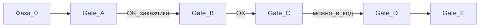

# D0 — Контекст проекта

**Revision:** `rev-gate-a-approved-20261022`  
**Статус Gate A:** согласован **условно** (три корректировки Deal/Quote/Project — [ADR-008](./adr/008-deal-quote-project-identity.md)); снимок `docs/revisions/rev-gate-a-approved-20261022/`.

---

## 1. Цель

Спроектировать **профессиональную платформу MultiFrame Партнёр** для коммерческих партнёров — **потолочных компаний** (натяжные потолки), которые продают и монтируют MultiFrame как слой звукоизоляции под полотном.

Кабинет — не набор подключённых виджетов и не пять визуальных клонов одного списка объектов. Это единая платформа с общей IA, где роли отличаются **работой**, а не оболочкой.

Проектирование идёт **спеками и гейтами** до любого продуктового кода. Этот пакет — **Gate A** (архитектура, сценарии, IA).

---

## 2. Сегмент и специализация

| Аспект | Решение для потолочников |
|--------|--------------------------|
| Зачем пришёл клиент | За **натяжным потолком** (и ремонтом комнаты), не «с жалобой на шум» |
| Роль Проблемомера | Помочь **сформировать и показать** потребность в ЗИ в контексте потолка |
| Вопрос «тип потолка» | В **основном пути партнёра** не спрашивать лишний раз; акустические параметры модели сохраняются |
| «Следующий шаг» | Реальные действия с сохранением **проекта / комнаты** |
| Стены в калькуляторе | **Вне основного UI** сегмента; алгоритмы стен в коде не удалять |
| Save расчёта | В **конкретную комнату** (preliminary и detailed); либо quick-entry → bind/create — без orphan |

Опора по акустике (не целевой UX кабинета): `apps/web/PRODUCT_SPEC.md`. Ядро акустики и геометрии раскладки **не трогаем** как алгоритмы.

---

## 3. Пять ролей (обзор)

| Роль | Кто | Главный фокус домашнего экрана |
|------|-----|--------------------------------|
| **admin** (StP) | Сеть MultiFrame / StP | Партнёры, сигналы сети, помощь, материалы обучения |
| **owner** | Владелец потолочной компании | Проекты компании, прайс/орг, сотрудники, контроль воронки |
| **sales** | Менеджер | Сделки и КП; сам может PM и preliminary calc; назначения |
| **measurer** | Замерщик | Черновики и замеры; PM + detailed calc в комнату |
| **crew** | Бригада / монтаж | Задания, чек-лист P0, фиксация препятствий, open/close |

Подробно: [02-role-scenarios.md](./02-role-scenarios.md), [02a-responsibility-matrix.md](./02a-responsibility-matrix.md).

---

## 4. Фаза 0 — снимок репозитория

| Поле | Значение |
|------|----------|
| Workspace | `/workspace` |
| Branch | `main` (tracked `origin/main`) |
| SHA | `953be7ed7ddc1bddd1a2c0834ccee6cdeec47fbf` |
| Инвентарь UX | [`../internal/partner-cabinet-ux-inventory.md`](../internal/partner-cabinet-ux-inventory.md) |
| План | `/opt/cursor/artifacts/plans/ux_design_first_01b09231.plan.md` |

### 4.1 Режимы работы фронта

| Режим | Как включается | Поведение |
|-------|----------------|-----------|
| **Демо-переключатель ролей** | `?demo=1`, или `VITE_DEMO_MODE=true`, или `localStorage mf_demo_mode=1` | Сетка демо-логинов, FAB смены роли; демо-PDF без бакета |
| **Remote API** | Задан `VITE_API_URL` (без завершающего `/`) | JWT-сессия, объекты/проекты/материалы с API |
| **Локальный offline** | `VITE_API_URL` пуст | `localStorage` / outbox; те же роли; сделки через `localDeals` |
| **Калькулятор** | Route `calculator` | iframe + `postMessage` `mf-cabinet-calc`; в коде area-only часто не пишется — в **целевой** IA preliminary **сохраняется** в комнату (ADR-005 draft-2) |
| **Проблемомер** | Route `problemomer` | In-app `AppShell` под тем же tool chrome |

Демо и remote **ортогональны**: можно смотреть демо-роли против облака или против localStorage. Для проектирования UX это значит: сценарии должны жить без опоры на «всегда есть seed из 11 карточек».

### 4.2 Опора в коде (только чтение)

- Shell: `apps/web/src/App.tsx`, `CabinetScreen`, role homes  
- Проекты/комнаты: `ObjectsPanel` (+ `projectGroups`), orphan `ProjectsCabinet` / `ProjectDetail`  
- Коммерция: `commercial/*`, `packages/shared/deal.ts`, `quote.ts`  
- Домен: `packages/shared/partner.ts`  
- Академия: `academy/*` (сейчас два чат-тренажёра)  
- Docs: `docs/ux-audit.md`, SDD `progress.md` / `report-for-chatgpt.md`, `PRODUCT_SPEC.md`

---

## 5. Гейты и запреты

| Сейчас | Запрещено без явного OK |
|--------|-------------------------|
| Фаза 0 + D0–D3 / D2a / ADR / review | Продуктовый код (`apps/web`, `apps/api`, правка packages) |
| Пакет «к согласованию» | Gate B (D4–D11 как готовые спеки) |
| | Помечать Gate A согласованным |
| | Wireframes / HTML-прототипы (Gate C) |

---

## 6. P0 / P1 продуктовые ставки (для проектирования)

**P0 (должны быть верны в Gate A архитектуре):**

- Единая IA: Проект → Комнаты → (инструменты / документы / сделка).  
- Deal ≠ статус JobObject; КП: copy/PDF ≠ sent; SoT outcome на Deal.  
- Два типа расчёта у комнаты: preliminary + detailed; без двойного суммирования.  
- Save calc / профиль PM → комната (или quick-entry: tool → result → Save → bind → persist).  
- Sales сам: PM и preliminary; detailed при разрешении; owner создаёт staff; sales — назначения.  
- Одна активная Deal; после closed — **новый dealId**; Project ≠ Deal closed при deferred; early decline/pause до КП.  
- Sent QuoteRevision immutable; tech-ready перед install (detailed ≠ preliminary).  
- Роли: разные next actions и RBAC, один каркас экранов.  
- Потолочная специализация PM/Calc (см. §2).  
- Монтажный чек-лист (обязателен; N/A с причиной) + blockers.  
- Контур StP-аналитики: сигнал → диагностика → действие → проверка применения → результат; training ≠ продажи.

**P1 (заложить в IA, деталь — Gate B):**

- Академия: не-чат механики (хаб + продажи-чат — уже в P0 каркасе).  
- StP support depth / пороги сигналов (каркас контура — уже P0).  
- Snapshot-поля QuoteRevision / API immutability (принцип — P0).  
- Исключения waive чек-листа.

**P2 (не блокируют Gate A):** напоминания по срокам, серверный поиск, маршруты до адреса, AI-тренер.

---

## Приложение A — P0-разрывы (логика / интеграция / UX)

Это **вход для проектирования**, не чеклист «Done» и не план фич-PR. Источники: код homes/ObjectsPanel/commercial/App, `partner.ts`/`deal`/`quote`, ux-audit, SDD rulings, PRODUCT_SPEC, inventory.

### A.1 Модель ↔ UI

| # | Разрыв | Почему P0 |
|---|--------|-----------|
| A1 | **Две оси статусов.** `JobObjectStatus` (`draft→…→quote_sent→install→closed`) и `Deal.stage` / `outcome` независимы по ruling, но домашний UI и `nextActions` всё ещё сильно завязаны на статусы объекта (`measured`→«Сформировать КП», `quote_sent`→follow-up). Риск двойного смысла «КП отправлено». | Менеджер и аналитика путают объект и сделку |
| A2 | **CommercialPanel не привязан к выбору пользователя.** `useCommercialDeals` берёт «первый попавшийся» `projectId` из objects/projects, а не выбранную карточку в ObjectsPanel. КП/assignments живут рядом со списком, но не в его контексте. | Потеря контекста проекта |
| A3 | **Orphan UI проектов.** `ProjectsCabinet` / `ProjectDetail` / `ProjectsPanel` есть в дереве, но **не монтируются** в role homes; рабочий путь — `ObjectsPanel` + `buildProjectCards`. Два конкурирующих каркаса «проект/комната». | IA для rewrite неоднозначна |
| A4 | **Вертикальный стек на табе «Сделки/Объекты».** Owner/Sales: WorkToday + EntryPoints + ObjectsPanel + CommercialPanel подряд. Нарушает принцип «один экран — одна работа»; на mobile — длинный скролл без иерархии. | UX и будущие screen specs |
| A5 | **Пять homes ≈ одна оболочка.** Различаются вкладки и lead-текст; ядро — тот же ObjectsPanel. Plan требует: одна платформа ≠ пять клонов. | Архитектурный риск Gate A |

### A.2 Инструменты и handoff

| # | Разрыв | Почему P0 |
|---|--------|-----------|
| B1 | **«Быстрый расчёт» / Tools без комнаты.** `requestCalculator(null)` → calc без `objectId`; save через postMessage может создать/обновить объект вне явного выбора комнаты. Нет доминирующего CTA «Сохранить в эту комнату». | Потеря projectId/room |
| B2 | **Area-only молча не сохраняется.** В коде — нет persist; нет объяснения «предварительная площадь ≠ раскладка». Целевая IA draft-2: preliminary **сохраняется** в комнату отдельно от detailed. | Ложные ожидания / потеря ориентира |
| B3 | **Проблемомер PRODUCT_SPEC** спрашивает тип потолка (натяжной / ГКЛ / …) — для партнёра-потолочника основной путь избыточен; «Следующий шаг» на Result ориентирован на visitor/StP CTA, не на кабинетный проект/комнату. | Специализация сегмента |
| B4 | **Стены в калькуляторе** присутствуют в коде (`wall-*`); для потолочного UI не зафиксирован продуктовый принцип «стены вне основного пути». | Scope UI |

### A.3 Коммерция и роли

| # | Разрыв | Почему P0 |
|---|--------|-----------|
| C1 | EntryPoints ведут в tool routes **без обязательного** создания/выбора проекта. | Разрыв golden path |
| C2 | Measurer nextActions не знают Deal; Crew не видит коммерцию (ок), но статус `install` на объекте остаётся единственным триггером — без явной связи с `Deal.stage = install`. | Handoff sales→crew |
| C3 | README/исторические тексты vs SDD: цены в смете видят все роли включая crew; redact сумм КП для crew на API — отдельный слой. Документация и ожидания расходятся. | Доверие к праву доступа |
| C4 | MF-16 монтажный чек-лист **отсутствует** в коде — бригада закрывает статус без пунктов и без фиксации препятствий. В Gate A архитектуре чек-лист + blockers = **P0** (не «потом»). | Сценарий crew |
| C5 | `canDeleteObjects(admin)` и Admin tab «projects»→ObjectsPanel — admin может выглядеть операционистом чужой компании; `canManageStaff(sales)` шире, чем «только assign». | Границы ролей |

### A.4 Академия и StP

| # | Разрыв | Почему P0 для IA (деталь D9 — Gate B) |
|---|--------|--------------------------------------|
| D1 | Академия = два **чат/сценарий**-тренажёра (sell + objections). Нет места в IA для монтажных / расчётных механик. | Риск «вся Академия = чат» |
| D2 | Обучение смешано с HelpTrainingPanel (материалы + инструкция кабинета + вход в Academy) — границы «справка / тренажёр / библиотека» размыты. | Навигация |

### A.5 Не P0-галочки

Исправления из `docs/ux-audit.md` (тач-таргеты, бейджи, поиск) — полезный фон, но **не** закрывают архитектурные разрывы A1–A5 / B1–B4. Gate A проектирует целевую IA поверх текущего кода как **аудита**, не как целевого UX.

---

## 7. Связанные документы

- [01-product-architecture.md](./01-product-architecture.md)  
- [gate-a-review.md](./gate-a-review.md)  
- [adr/README.md](./adr/README.md)
